# DrugInsight AI — Database Schema Specification

## 1. Database Overview

The platform uses SQLAlchemy 2.0 ORM with asynchronous drivers (`asyncpg` for PostgreSQL with `pgvector`, and `aiosqlite` for local developer testing).

All primary keys use 36-character UUID strings (`uuid.uuid4()`).

---

## 2. Entity Relationship Diagram (ERD)

```mermaid
erDiagram
    users ||--o{ verification_requests : "submits"
    users ||--o{ refresh_tokens : "owns"
    users ||--o{ ai_conversations : "participates in"
    users ||--o{ saved_research : "saves"
    users ||--o{ research_reports : "compiles"
    verification_requests ||--o{ verification_documents : "attaches"
    ai_conversations ||--o{ ai_messages : "contains"
    ai_messages ||--o{ ai_citations : "cites"
    medicines ||--o{ medicine_labels : "has revisions"
    medicine_labels ||--o{ document_chunks : "chunked into"

    users {
        string id PK
        string full_name
        string email UK
        string password_hash
        string role
        boolean is_active
        datetime created_at
        datetime last_login_at
    }

    verification_requests {
        string id PK
        string user_id FK
        string requested_role
        string institution
        string status
        datetime submitted_at
        string reviewed_by
    }

    medicines {
        string id PK
        string generic_name
        string brand_name
        string active_ingredients
        string medicine_category
        string formulation
    }

    medicine_labels {
        string id PK
        string medicine_id FK
        string label_identifier
        string source_name
        text boxed_warning
        text contraindications
        boolean is_current
    }

    document_chunks {
        string id PK
        string medicine_label_id FK
        string section_name
        text chunk_text
        text embedding_json
    }

    audit_logs {
        string id PK
        string actor_user_id
        string action
        string resource_type
        string result
        string ip_address
        datetime timestamp
    }
```

---

## 3. Detailed Table Specifications

### `users`
- `id`: `String(36)`, Primary Key
- `full_name`: `String(150)`, Not Null
- `email`: `String(255)`, Unique, Indexed, Not Null
- `password_hash`: `String(255)`, Argon2id encoded string
- `role`: `String(30)`, Default `"PUBLIC"`. Allowed: `PUBLIC`, `DOCTOR`, `RESEARCHER`, `ADMIN`
- `is_active`: `Boolean`, Default `True`
- `institution`, `department`, `medical_registration_number`, `licensing_authority`, `jurisdiction`: Nullable professional credentials
- `created_at`, `updated_at`, `last_login_at`: `DateTime`

### `verification_requests`
- `id`: `String(36)`, Primary Key
- `user_id`: `String(36)`, Foreign Key to `users.id` (CASCADE)
- `requested_role`: `String(30)` (`DOCTOR` or `RESEARCHER`)
- `institution`: `String(255)`, Not Null
- `status`: `String(30)`, Default `"PENDING"`. Allowed: `PENDING`, `APPROVED`, `REJECTED`, `MORE_INFO_REQUIRED`, `REVOKED`
- `admin_notes`: `String(1000)`, Reviewer feedback

### `medicines`
- `id`: `String(100)`, Primary Key (normalized lowercase slug, e.g. `metformin`, `atorvastatin`)
- `generic_name`: `String(255)`, Indexed
- `brand_name`: `String(255)`, Indexed
- `active_ingredients`: `String(255)`
- `medicine_category`: `String(100)`, Indexed
- `formulation`: `String(150)`

### `medicine_labels`
- `id`: `String(36)`, Primary Key
- `medicine_id`: `String(100)`, Foreign Key to `medicines.id` (CASCADE)
- `label_identifier`: `String(150)`, SPL Set ID or NDC reference
- `source_name`: `String(100)` (`DailyMed` or `openFDA`)
- `boxed_warning`: `Text`, Nullable
- `indications`, `dosage_and_administration`, `contraindications`, `warnings`, `adverse_reactions`: `Text`
- `is_current`: `Boolean`, Default `True`

### `document_chunks`
- `id`: `String(36)`, Primary Key
- `medicine_label_id`: `String(36)`, Foreign Key to `medicine_labels.id` (CASCADE)
- `section_name`: `String(100)`, Labeling heading (e.g. `boxed_warning`, `contraindications`, `adverse_reactions`)
- `chunk_text`: `Text`, Extracted content
- `embedding_json`: `Text`, 128-dimensional vector serialized as JSON array
- `content_hash`: `String(64)`, SHA-256 integrity hash

### `audit_logs`
- `id`: `String(36)`, Primary Key
- `actor_user_id`: `String(36)`, Nullable (null for unauthenticated system events)
- `actor_name`: `String(150)`, User display name or `"System"`
- `action`: `String(100)`, Indexed (e.g. `LOGIN_SUCCESS`, `VERIFICATION_APPROVED`, `AI_SAFETY_REFUSAL`)
- `resource_type`: `String(100)`
- `result`: `String(30)` (`Success`, `Warning`, `Failed`)
- `ip_address`: `String(45)`
- `timestamp`: `DateTime`, Default UTC
- `details`: `Text`, Event payload description
